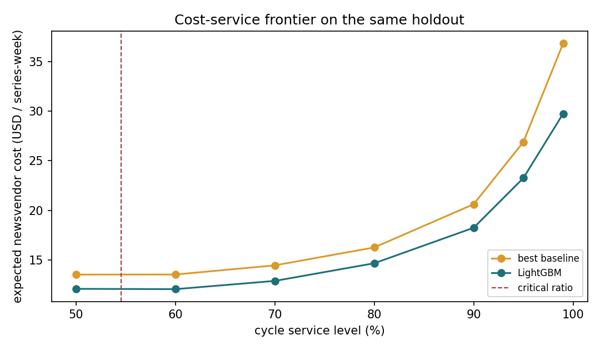

# M5 周度需求预测：FVA 和 newsvendor

用 M5（Walmart 真实销售数据）做一个 item-store 级的周度需求预测。这个项目不是再比一次模型，主要想回答三个问题：

1. 简单基准到底有多强？
2. LightGBM 相对最强基准的 FVA 是多少？
3. 误差降下来，订货成本能降多少？

数据、代码、图表和结果都在仓库里，可以直接复现。

## 数据

M5 来自 Kaggle 的 Walmart 销售竞赛，包含 10 家店、3,049 个商品、1,941 天的日销量，还有日历事件和每周价格。

这个仓库取了 **100 个 item-store series**：每家店销量最高的 5 个，再随机抽 50 个。这样既不会全是畅销品，也不至于被长尾噪声淹没。

- 日销量聚成周销量（周一到周日）
- 最后 **26 周**做 holdout，前面按时间切分，不随机打乱
- 价格来自 `sell_prices.csv`，按周平均后并到 series 上
- 训练时只用 holdout 之前的数据

数据文件约 320MB，没有进 git。第一次运行先下载：

```bash
python scripts/download_data.py
```

脚本用并行 range 请求从 Hugging Face 的公开镜像拉，单连接会被限速。

## 方法

**基准**

| 模型 | 做法 |
|---|---|
| naive | 上周销量 |
| seasonal naive | 去年同周 |
| MA4 | 过去 4 周均值 |

**LightGBM**

特征包括 lag 1/2/3/4/8/13/26/52 周，4/8/13/26/52 周滚动均值和标准差，13 周零销量占比，8 周 EWM，周内位置的正余弦，月份/年份，事件和 SNAP 标记，价格、相对价格和价格变化。

模型不是直接预测销量，而是**预测相对 naive 的残差**：最终预测 = naive + 残差。原因是树模型在时间外推上比较弱，直接预测在 holdout 上会系统性低预测；锚在 naive 上更稳。这个对比在下面有数。

**评估**

- MAE、RMSE、偏差、每家店的 tracking signal（Σerror / MAD，|TS| > 4 视为有偏）
- FVA = 1 − 模型 MAE / 基准 MAE
- 所有模型都在同一个 26 周 holdout 上算

**Newsvendor**

临界比 CR = Cu / (Cu + Co) = 0.30 / (0.30 + 0.25) = 0.545。每家店用自己 holdout 误差的经验分位数订货，成本和正态近似对比。

## 结果

### 预测精度

| 模型 | MAE | RMSE | 偏差 | \|TS\|>4 | FVA vs naive |
|---|---|---|---|---|---|
| **LightGBM（残差）** | **22.77** | **47.24** | −1.90 | 38/100 | **+10.2%** |
| naive | 25.36 | 59.85 | +0.08 | 2/100 | 0 |
| MA4 | 28.08 | 66.74 | −0.18 | 21/100 | −10.7% |
| seasonal naive | 37.38 | 79.37 | +5.66 | 80/100 | −47.4% |


两个和直觉不太一样的地方：

- **naive 很强。** 在这 100 个 series 上，MA4 和 seasonal naive 都没打赢它；seasonal naive 在最后 26 周甚至差了 47%。这不是 seasonal 方法本身不行，是这段窗口的水平和前一年对不上，硬套 52 周滞后会吃亏。
- **直接预测不如残差模型。** 同样特征下，直接预测销量 MAE 23.36、FVA +7.9%；改成预测 naive 残差后 MAE 22.77、FVA +10.2%。树模型外推趋势吃亏，这个差距基本就是它带来的。


模型还是有偏：38/100 家店的 |TS| > 4，中位 TS −2.59。说明它整体上略微低预测，还没到“调好了”的程度。

### Newsvendor

| 策略 | 期望成本（$/series-week） |
|---|---|
| 最强基准（naive） | $13.48 |
| LightGBM | **$12.02（−10.9%）** |
| 正态近似（naive 误差） | 比经验分位高 2.4% |



服务水平从 50% 提到 99%，成本从 $13 左右涨到 $35–37；80% 之后边际成本明显变陡。这和库存项目的结论一致：**不是服务水平越高越好，得看缺货成本和持有成本的比例**。

## 几个判断

- FVA 的分母要用**同窗口的最强基准**，不是随手拿 naive。这个项目里 naive 恰好最强，但换个窗口，seasonal 可能翻上来。
- 预测提升 10%，newsvendor 成本也降约 10%，因为误差是线性传导的。真正决定省多少钱的，还是缺货/持有成本参数。
- 100 个 series 不是全量 M5。换成全部 30,490 个 series，长尾和零销量会更多，FVA 大概率会变。
- 价格只用了每周均价，没有促销标记；M5 的促销信息藏在价格变化里，这块还能再挖。

## 运行

```bash
pip install -r requirements.txt
python scripts/download_data.py
python scripts/run_analysis.py

#  ablation：直接预测销量 vs 预测 naive 残差
python scripts/run_analysis.py --direct
```

结果写到 `results/`，图写到 `images/`，包括 `model_metrics.csv`、`model_metrics_direct.csv`、`predictions_test.csv`、`newsvendor_summary.csv`、`diagnostics.json`。

## 文件

```
src/m5.py                 数据加载、选 series、周度聚合、特征、基准、切分
src/evaluation.py         MAE/RMSE/bias/tracking signal/FVA、newsvendor
scripts/download_data.py  并行下载 M5
scripts/run_analysis.py   端到端流程
tests/                    合成数据单测
results/                  指标、预测、newsvendor 结果
images/                   预测示例、模型对比、成本-服务前沿
```

## 数据来源

M5 Forecasting – Accuracy（Kaggle）。这里通过 Hugging Face 的公开镜像下载，文件是 `calendar.csv`、`sales_train_validation.csv`、`sell_prices.csv`。数据版权归原竞赛/沃尔玛所有，本仓库只用于学习和复现。
