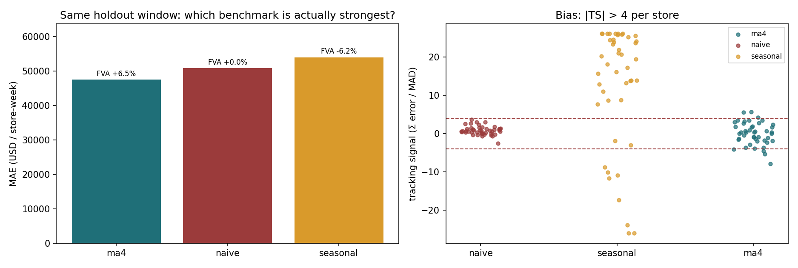

# 需求预测与库存决策：门店级 LSTM + M5 概率预测

[](https://opensource.org/licenses/MIT) [](https://www.python.org/) [](https://github.com/lingtao-meng/lstm-attention-demand-forecasting/actions/workflows/ci.yml)


这个仓库有两块内容：

1. **门店级预测**（根目录）：用 Walmart 数据训练 LSTM + Self-Attention，做未来 4 周销售预测，并接到安全库存 / newsvendor。
2. **M5 item-store 预测**（`m5/`）：100 个 item-store series 的周度预测，补了分位数、conformal、滚动回测和分层 reconciliation。

两块都是“预测 → 决策”，不是只比模型指标。根目录的门店级模型还带一个 Streamlit 应用。

## 项目结构

| 模块 | 内容 | 入口 |
|---|---|---|
| 门店级预测 | Walmart 45 店、LSTM+Attention、四步点预测、FVA、newsvendor | `scripts/`、`app/` |
| M5 预测 | 100 个 item-store series、LightGBM 残差、conformal、六折滚动、分层 | [`m5/README.md`](m5/README.md) |


在线应用：[点击试用](https://lstm-attention-demand-forecasting-94s4zjmdvbzoar6sqh5zqx.streamlit.app)

## 数据

Walmart Recruiting - Store Sales Forecasting，Kaggle 公开数据集。45 家门店，143 周的周销售数据。特征包括周销售额、节假日标记、温度、油价、CPI、失业率。

## 模型结构

输入层（过去12周×6个特征）→ 双层双向 LSTM → Multi-Head Self-Attention → 残差连接 + LayerNorm → 全连接层 → 输出未来4周销量。

可复现版本是 `scripts/train_lstm_forecast.py` 的四步点预测（目标为周销售额，不是商品件数）。旧 notebook/App 的“3 分位头”是早期演示，不再作为主结果；分位数预测在 `m5/` 模块里用 conformal 实现。

主实验训练 25 个 epoch，按验证损失选最佳检查点；默认 Attention 模型约 20.3 万参数。在 Mac 上跑的。

## 效果对比

当前可复现结果统一用 `scripts/train_lstm_forecast.py` 的同一批 1,440 个测试起点、四步目标、标准化 MAE：

| 模型 | 四步 MAE | 相对 naive |
|---|---|---|
| MA4（同起点、同四步） | **0.1011** | **+12.1%** |
| 纯 LSTM | 0.1059 | +8.0% |
| LSTM + Attention | 0.1062 | +7.7% |
| naive（最后一周重复四周） | 0.1151 | — |

结论：

- LSTM + Attention 相对四步 naive 改善 **7.7%**；
- 但同一批起点下，MA4 比 naive 好 **12.1%**，Attention 比 MA4 反而高 **5.03%**；
- 纯 LSTM 略好于 Attention（8.0% vs 7.7%），所以不能写“注意力机制提升精度”。

旧六模型表（ARIMA/XGBoost/Prophet 等）是早期不同窗口、不同步长的结果，不再放在这里做比较；历史记录保留在 notebook 里。

## 扩展实验

**消融实验（真实重跑 2026-10-27）：** 同一时间切分、同一随机种子、各 25 epoch，
纯 LSTM 四步 MAE 均值 **0.1059**，LSTM+Attention **0.1062**——纯 LSTM 略好，
但只差 0.3%，**不足以支撑「注意力没用」的强结论**。

> 早期版本的手填消融数字没有训练支撑，对应 notebook 单元只打印字符串，已删除。当前只报上面真实重跑的 7%–8% 量级。

**回顾窗口实验（真实重跑 2026-10-27）：** 4/8/12/16 周各训练 25 epoch，单 seed：

| 输入窗口 | 四步 MAE | 相对 naive |
|---|---|---|
| 4 周 | 0.1046 | +9.39% |
| 8 周 | 0.1050 | +8.99% |
| 12 周 | 0.1062 | +7.71% |
| 16 周 | 0.0981 | **+14.66%** |

这次 16 周最好，不是原稿说的 8 周。差异可能来自 seed 和训练轮数，先不把它当成稳定结论。

原稿窗口数字引用了未定义变量 `imp`，没有可复现来源，已删除；当前只报上表真实重跑结果。

**Optuna 搜索（真实重跑 2026-10-27）：** 5 个 trial、25 epoch，按验证集 MAE 选参；最优验证 MAE **0.1978**，参数为 hidden=96、layers=1、lr=0.00252、dropout=0.386。日志和 trial 明细在 `results/lstm_optuna.json`。主表仍用默认配置，没有把调参结果当成测试集提升。

**滚动交叉验证（按目标日期划界，5 折 × 12 周）：** 结果仍不稳定：

| 折 | 测试目标日期 | 模型 MAE | naive MAE | 相对 naive |
|---|---|---|---|---|
| 1 | 2011-09-03 ~ 2011-11-25 | 0.1701 | 0.1361 | −24.9% |
| 2 | 2011-11-26 ~ 2012-02-17 | 0.2979 | 0.4592 | **+35.1%** |
| 3 | 2012-02-18 ~ 2012-05-11 | 0.1137 | 0.1380 | +17.6% |
| 4 | 2012-05-12 ~ 2012-08-03 | 0.1057 | 0.1046 | −1.0% |
| 5 | 2012-08-04 ~ 2012-10-26 | 0.0918 | 0.1078 | +14.8% |

均值 **+8.3% ± 20.2%**，2 折输给 naive。折内训练/验证/测试按目标日期划界，跨界的四周窗口被剔除，scaler 只用训练区。

> 诚实结论：**单次时间切分好约 8%，滚动回测均值也约 8%，但方差很大，不能宣称"稳定优势"。**

## 预测精度值多少钱：从误差到库存

> ⚠️ **本节是教学情景，不是本模型的实测收益。** 下面的 7.7% 是这次四步重跑的实测改善，但把它按同比例传导到所有门店的误差分布，仍然是一个情景假设（脚本把 sigma 乘 0.923）；滚动回测不稳定。因此本节的金额只能说明「如果误差按这个比例下降，库存会怎样」，不能当作企业实测降本。

MAE 降 7.7% 是这次四步重跑的实测改善；把它按同比例传导到误差分布，然后呢？计划岗真正关心的是这一步——**误差下降能换来多少安全库存和持有成本**。

`scripts/forecast_to_inventory.py` 用 Walmart 数据做了这个换算：

1. 先用 naive 基线（上周销量当本周预测）算出**真实误差分布**——不是拍脑袋的假设；
2. 假设新模型误差按同比例缩小（σ_model = 0.923 × σ_naive，即 7.7% 改善）；
3. 按 `SS = z · σ_error · √L`（L = 4 周提前期）反推安全库存与年持有成本。

结果（45 家门店，95% 服务水平，持有成本率 25%/年）：

| 指标 | naive 基线 | LSTM + Attention | 变化 |
|---|---|---|---|
| 周度绝对误差 MAE 合计 | $3,822,095 | $3,527,593 | −7.7% |
| 安全库存（45 店合计） | $22,599,992 | $20,857,532 | **−7.7%** |
| 年持有成本 | $5,649,998 | $5,214,383 | **省 $435,615** |

服务水平取 90% / 95% / 99% 时，年节省分别是 $339k / $436k / $616k。

> **口径说明**：这是情景推算，不是企业实测。7.7% 来自真实四步重跑，但“所有门店误差同比例缩小”仍是假设；安全库存对误差是线性的，MAE 降幅不能直接推出标准差和尾部分位数同比例下降。

复现：`python scripts/forecast_to_inventory.py --improvement 0.0771`

## 预测值不值：FVA 与 newsvendor

真实四步重跑相对 naive 约 +7.7%，但 naive 不是最强基准：在同一 holdout 窗口上，
4 周移动平均（MA4）和 seasonal naive 都可能更强。所以我先做了两件事。

### 1. FVA：26 周单步诊断（不是上面的四步主实验）



固定最后 26 周（45 店 × 26 周）的单步诊断，只用可复现的美元空间基准；它和上面的四步主实验不是同一评估口径：

| 模型 | MAE | FVA vs naive | 偏差 | 中位跟踪信号 | \|TS\|>4 |
|---|---|---|---|---|---|
| **MA4** | **47,554** | **+6.5%** | +0.01% | 0.31 | 7/45 |
| naive | 50,865 | 0 | +0.15% | 0.63 | 0/45 |
| seasonal naive | 54,031 | −6.2% | +2.03% | 18.07 | 43/45 |

- **MA4 才是最强简单基准**；seasonal naive 在这 26 周反而比 naive 差 6.2%，而且 43/45 家店
  \|TS\| > 4，说明它是系统性有偏的（全窗口上它更好，是窗口效应，不能直接搬到部署）。
- 这组 26 周单步表不能拿来推“模型胜 MA4”：同起点四步比较里 MA4 MAE 0.1011、Attention 0.1062，
  模型反而高 5.03%。正式引用请用上面的四步主表。
- 所以 FVA 的分母该用 MA4，不是 naive。另外，报告 FVA 的时候得把评估窗口和基准一起写出来，不然数字没法比。

### 2. Newsvendor：误差分布形状也值钱


给定缺货成本 Cu = 0.30、持有成本 Co = 0.25，临界比 CR = Cu/(Cu+Co) = 0.545；
最优订货量 = 预测 + 误差分布的 CR 分位数。

| 方法 | 期望成本（$/店-周） | 相对经验分位 |
|---|---|---|
| 经验分位数（MA4 误差） | **$12,666** | — |
| 正态近似 | $12,975 | +2.4% |
| 误差缩减 7.7%（假设情景，不是独立样本外校准） | **$11,690** | **−7.7%** |

- 误差分布厚尾/偏斜，**经验分位数比正态近似更稳**（正态多花 2.4%）。
- 服务水平从 80% 提到 95%，成本从 $15.9k 涨到 $23.0k；0.8 之后边际成本陡增。
- 预测误差下降会**线性**传导到 newsvendor 成本——这和安全库存的口径一致，但 newsvendor
  把缺货成本显式写出来了。

```bash
python scripts/forecast_diagnostics.py
python scripts/forecast_diagnostics.py --holdout 12 --underage 0.4
```

## M5 模块

`m5/` 是同一主题下的扩展：M5 真实 Walmart 销售，100 个 item-store series，最后 26 周 holdout。

- 点预测：LightGBM 残差，单窗口 FVA +6.4%；六折滚动 +4.3% ± 2.9%
- 概率预测：P10/P50/P90 + conformal，80% 区间覆盖 80.8%
- 订货：P50+conformal 的 newsvendor 成本 $13.28，比 naive+conformal 低 9.3%
- 分层：114 个节点，bottom-up 赢 MinT-OLS

详细结果、图和复现命令见 [`m5/README.md`](m5/README.md)。

## 一些踩过的坑

最初打算用 Google 的 Temporal Fusion Transformer（TFT），结果 pytorch-forecasting 和 pytorch-lightning 的版本冲突搞了很久没搞定。最后放弃了，直接用 PyTorch 从零写 LSTM+Attention。回头看这个决定反而是对的——手写一遍对底层理解深了很多。

**关于 MAE 的口径（重要）**：当前主表统一用同一批 1,440 个测试起点、四步目标的标准化 MAE，不再混用旧美元反推值和不同步长的 ARIMA/Prophet 结果。真实四步重跑约 +7.7%，滚动回测不稳定。

## 运行

```bash
pip install torch pandas numpy matplotlib seaborn scikit-learn streamlit
jupyter notebook lstm_demand_forecast.ipynb

# 预测诊断：FVA + tracking signal + newsvendor
python scripts/forecast_diagnostics.py

# M5 模块（数据约 320MB，先下载）
cd m5
pip install -r requirements.txt
python scripts/download_data.py
python scripts/run_analysis.py
python scripts/run_probabilistic.py
python scripts/rolling_backtest.py
python scripts/hierarchical.py
cd ..

# Streamlit app
cd app && streamlit run app.py
```

## License

MIT
