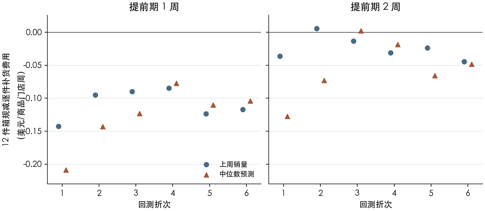

# 需求预测与订货分析：45店LSTM与M5概率预测

[](https://github.com/lingtao-meng/lstm-attention-demand-forecasting/actions/workflows/ci.yml)
[](LICENSE)

基于两组Walmart公开数据，研究从历史记录到预测、再到订货成本的过程。45店部分预测未来四周销售额；M5扩展预测商品门店周销量，并检验预测区间与单周期订货方案。

## 主要结果

<!-- results:start -->
- 45店四步预测：1,440 个测试起点，Attention MAE **0.1062**，相对四步 naive 改善 **7.71%**；MA4 为 **0.1011**。
- 五折回测相对 naive 的改善均值 **8.32%**，折间标准差 **20.20 个百分点**。
- M5 概率订货：同样使用独立校准，P50成本 **$13.28**，naive成本 **$14.65** / 商品门店周。
<!-- results:end -->

结果的样本、单位和比较基准见 [自动核对表](docs/RESULTS.md)。
零基础阅读可从 [数据如何走到预测与订货](docs/WALKTHROUGH.md) 开始。



图中每条短线连接同一测试期的两种箱规，零线上方表示费用高于逐件补货。在 M5 六折回放中，提前期 1 周时，两种预测输入采用 12 件箱规的费用均下降。提前期 2 周时，12 件箱规在上周销量基准的第 2 折和中位数预测的第 3 折费用上升。[完整库存与服务对照](m5/INVENTORY_REPLAY.md)

## 稳健性补充实验

采用预先固定的5个种子，每次训练25个epoch，比较10次LSTM/Attention结果；M5部分比较两套选样方案的完整主窗口实验与各6折回测。

- 五种子固定窗口：Attention相对naive的改善均值 **10.15%**，纯LSTM **12.78%**；Attention仅在 **1/5** 个相同种子下优于纯LSTM。
- M5训练期选样：单窗口残差模型FVA **6.30%**，六折均值 **3.88%**；给定成本下，P50+校准较同样校准的naive成本低 **11.55%**。
- 训练随机性、时间窗口和选样总体分别报告。新的100条序列与原样本重合49条，绝对MAE或费用不作为同一样本的配对增量。

完整表格、缺失记录覆盖、配置和复现命令见 [稳健性报告](docs/ROBUSTNESS.md)。原主结果保持独立，核对命令为 `python scripts/verify_robustness.py`。

M5另有 [六折概率订货回测](m5/PROBABILISTIC_BACKTEST.md)，每折分别重训和校准，同时比较费用、区间覆盖和服务水平。

库存结转和提前期另见 [M5 多周期库存仿真](m5/INVENTORY_REPLAY.md)。

## 两条分析线分别做什么

| 分析线 | 对象与单位 | 输入与输出 | 主要入口 |
|---|---|---|---|
| 45店主实验 | 45家门店、143周；周销售额（美元） | 过去12周×6特征 → 未来4周点预测 | `scripts/train_lstm_forecast.py` |
| M5扩展 | 100条商品门店序列；周销量（件） | 历史滞后与日历价格 → 下一周销量、分位数与订货量 | [m5/README.md](m5/README.md) |

两条分析线任务不同，标准化销售额MAE与销量MAE不能直接横比。M5的26周是测试区间长度；模型逐周使用已观测历史进行一步预测，不是一次预测未来26周。


## 45店：实验设计比模型名称更重要

主模型使用双层双向LSTM、可选四头Self-Attention、残差连接、LayerNorm和四步输出。默认隐状态64，25个epoch，种子42，按验证损失选检查点。双向只读取已知的历史12周，不包含未来目标。

- 训练、验证、测试按四个目标周整体归属切分；跨界窗口剔除。
- 标准化仅用训练区估计，验证和测试复用同一变换。
- naive、MA4、纯LSTM和Attention比较同一批起点、同一四步目标。
- 同一次主实验中MA4更好，纯LSTM与Attention差异较小；因此保留多模型比较，不把注意力机制写成已证实的增益来源。
- 窗口实验比较4/8/12/16周；Optuna按验证集搜索5个trial。它们与默认主表分开，不能用测试集挑最优后再宣称无偏提升。
- 五折按日期滚动回测；每折12个epoch，与主实验25个epoch分别记录。结果说明窗口间差异，折间标准差不是均值的置信区间。

## M5：从销量预测到订货

M5补充商品门店粒度、完整零售周与价格连接、LightGBM残差模型、六折回测、P10/P50/P90、独立16周校准及114节点分层分析。订货成本用实际测试销量、非负订货量和给定缺货/积压系数计算。

预测平均误差下降，不必然让每一种订货成本同比下降；成本还取决于误差分布、分位数、价格和代价参数。M5用样本外计算检验这一关系，45店的安全库存金额换算则单列为教学情景。

## 复现与结果核对

```bash
pip install -r requirements.txt

# 四步主实验、纯LSTM对照与五折回测
python scripts/train_lstm_forecast.py --epochs 25 --folds 5 --seed 42

# 回顾窗口与Optuna，默认5个trial
python scripts/lstm_experiments.py --mode both --epochs 25 --trials 5

# M5完整入口见m5/README.md；仅核对当前保存产物：
python scripts/verify_results.py

# 结果变更后更新首页摘要及docs/RESULTS.md，再核对
python scripts/verify_results.py --write
```

核对命令直接从公开CSV重建45店目标，复算保存预测的MAE，并由M5逐行预测和订货量核对区间、成本及回测算式；它不会训练模型，不能替代上述正式实验。输入文件指纹随核对表保存。

## 补充材料

| 内容 | 文件 | 使用边界 |
|---|---|---|
| 输入窗口与调参 | `results/lstm_window_sweep.json`、`results/lstm_optuna.json` | 单种子实验；验证选参，单列报告 |
| 单步FVA与跟踪信号 | `scripts/forecast_diagnostics.py` | 26周单步诊断，与四步主实验分开 |
| 安全库存情景 | `scripts/forecast_to_inventory.py` | 假设误差同比缩放的金额演示，非实测库存收益 |
| 早期notebook | `lstm_demand_forecast.ipynb` | 历史探索，旧表不替代当前公平比较 |
| 早期网页 | `app/app.py` | 旧三分位模型和逐店缩放，与当前点预测及M5结果分开 |

数据来自Kaggle Walmart Store Sales与M5公开数据。数据权利归来源方；代码使用 [MIT License](LICENSE)。
