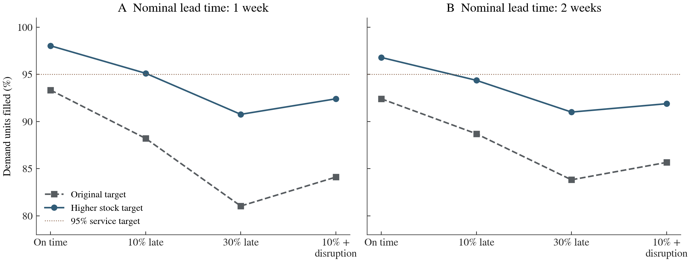

# 到货延误、箱规和库存缓冲

沿用 M5 六折样本外预测和已核验的补货目标。把订货提前期分为约定到货时间和额外延误。每种方案独立走完收货、订货、履约和库存结转，比较补货策略对供应波动的敏感性。

## 情景设计

- 约定提前期为 1 周或 2 周，每次延误条件下顺延 1 周。四类情景为全部准时、10% 随机延误、30% 随机延误，以及 10% 随机延误叠加两次集中延误。集中延误使各折第 8 周和第 15 周下的订单统一晚一周。
- 每折生成 40 条到货情景。同一折、同一商品门店、同一订货周的延误抽样在所有预测方法和库存策略间共用。两次下单可以在同一周到货，两笔收货量相加。截至开单时的现货与在途用于计算补货量，随后才结算该周销量。
- 箱规设为 1、6、12 件。比较原备货目标和预设提高的目标。提高目标采用 `1 + 0.5 / (约定提前期 + 1)` 倍，即两档提前期分别提高 25% 和约 16.7%。每折前 4 周预热，后 22 周计分，每套方案每条情景合并 13,200 条商品门店周。
- 模拟前固定各情景的随机种子和各策略的参数。逐件准时分支与已归档的八列库存轨迹逐项核对，每条压力轨迹按需求分解、现货、在途与整箱约束检查。费用沿用上一轮三组持货及缺货权重。延误频率和成本系数是给定情景。

## 服务和成本怎样变化



下表为 P50、提前期 1 周、逐件补货的六折合并结果。每列使用相同的到货情景，平均数量满足率为实际履约量占需求量的比值。成本单位为美元/商品门店周。

| 到货情景 | 原目标满足率 | 提高目标后满足率 | 提高目标后达到 95% 的情景数 | 原目标平衡费用 | 提高目标后平衡费用 |
| --- | ---: | ---: | ---: | ---: | ---: |
| 全部准时 | 93.34% | 98.04% | 40/40 | 5.8278 | 4.9959 |
| 10% 随机延误 | 88.21% | 95.12% | 30/40 | 9.2393 | 6.7282 |
| 30% 随机延误 | 81.03% | 90.76% | 0/40 | 13.8495 | 9.1532 |
| 10% + 两次集中延误 | 84.11% | 92.41% | 0/40 | 11.9714 | 8.3956 |

- 10% 随机延误下，提高目标且逐件补货，95% 服务目标在 30/40 条情景中达成。改用 12 件箱规后为 40/40，但相应平均期末现货由 130.16 件增至 134.90 件，平衡费用由 6.7282 上升至 6.8163。
- 在同样的 10% 随机延误下，逐件提高目标的平衡费用从 9.2393 降至 6.7282。如果按更看重持货费用的权重结算，费用从 7.5445 增至 9.0768。箱规和目标库存选择都要同时核对持货成本与服务底线。
- 保持原目标、逐件补货、约定提前期 1 周时，P50 相对上周销量的平衡费用优势由准时情景下的 0.6312 降至 30% 延误下的 0.0808 美元/商品门店周，数量满足率也由较高变为较低。到货波动和预测质量对服务的作用可以分开诊断。

达标情景数和 5%–95% 分位描述这 40 条随机延误轨迹在固定历史销量下的表现。服务阈值 90%、93%、95% 均可在汇总表查到。两次集中延误用于压力测试，数据中的历史销量继续作为需求代理。

[策略与服务汇总](results/inventory_delay_stress/summary.csv) · [分折数据](results/inventory_delay_stress/by_fold.csv) · [预测方法的配对差](results/inventory_delay_stress/paired.csv) · [逐条情景的配对差](results/inventory_delay_stress/paired_draws.csv)

```sh
python m5/scripts/inventory_delay_stress.py
```
